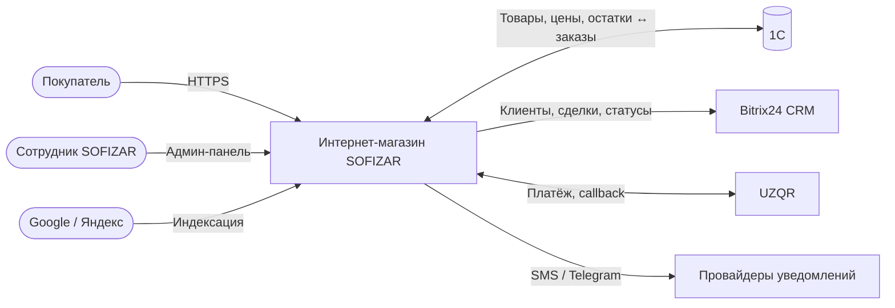
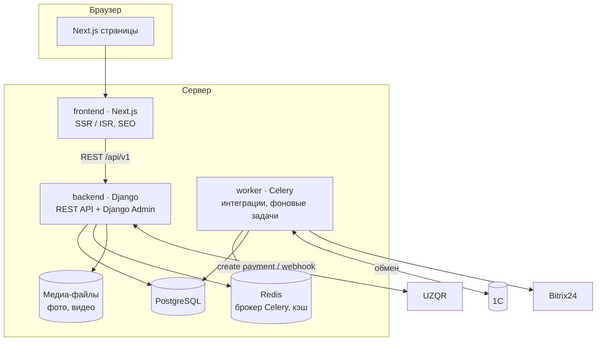

# HLD — High-Level Design

> Статус: **черновик v0.1** · Обновлён: 2026-11-10

Документ описывает общую архитектуру интернет-магазина SOFIZAR: из каких компонентов он состоит, как они связаны и как через них идут данные. Детали каждого модуля — в [`docs/lld/`](../lld/), обоснование решений — в [`docs/adr/`](../adr/).

## 1. Контекст

SOFIZAR — ювелирный завод в Узбекистане. Задача — интернет-магазин, который:

- показывает каталог изделий на трёх языках (UZ / RU / EN);
- принимает заказы 24/7 и онлайн-оплату через UZQR;
- автоматически берёт товары, цены и остатки из **1С** и возвращает туда заказы;
- передаёт клиентов и заказы в **Bitrix24 CRM**;
- хорошо индексируется поисковиками (SEO — ключевой канал продаж).

## 2. Контекстная диаграмма (C4, уровень 1)

## 3. Контейнеры (C4, уровень 2)

| Контейнер | Технология | Ответственность |
|---|---|---|
| `frontend` | Next.js (App Router, TypeScript) | Все публичные страницы, SSR/ISR, SEO-метаданные, sitemap, hreflang |
| `backend` | Django + Django REST Framework | Модель данных, REST API, Django Admin, приём webhook от UZQR |
| `worker` | Celery | Обмен с 1С, отправка в Bitrix24, уведомления — всё, что не должно тормозить запрос покупателя |
| `db` | PostgreSQL | Основное хранилище |
| `redis` | Redis | Брокер очередей Celery, кэш |

## 4. Ключевые потоки данных

### 4.1. Каталог: 1С → сайт
1. Celery по расписанию забирает изменения из 1С (товары, характеристики, цены, остатки).
2. Данные сопоставляются по `external_id` (GUID 1С) и артикулу, записываются в PostgreSQL.
3. Фото привязываются к товару по имени файла = артикул.
4. Next.js обновляет страницы товаров через ISR (revalidate) — покупатель видит актуальные цены без полной пересборки сайта.

Формат обмена (CommerceML или HTTP-сервис 1С с JSON) будет выбран после согласования с 1С-специалистом заказчика → отдельный ADR.

### 4.2. Заказ: сайт → 1С и Bitrix24
1. Покупатель оформляет заказ → `backend` создаёт `Order` со статусом «Новый».
2. В очередь ставятся задачи: передать заказ в 1С, создать/обновить контакт и сделку в Bitrix24.
3. Смена статуса в любой системе синхронизируется с остальными (детали — LLD «Статусы заказа»).

### 4.3. Оплата через UZQR
1. Покупатель выбирает UZQR → `backend` создаёт платёж и получает QR-код.
2. После оплаты UZQR присылает webhook → `backend` проверяет подпись, идемпотентно отмечает заказ оплаченным.
3. Статус «Оплачен» уходит в 1С и Bitrix24 через очередь.

## 5. Окружения

| Окружение | Назначение | Как запускается |
|---|---|---|
| `local` | Разработка | `docker compose up` |
| `staging` | Проверка заказчиком, тест интеграций | Сервер, автодеплой из ветки `dev` *(позже)* |
| `production` | Рабочий сайт | Сервер, автодеплой из `main` *(позже)* |

## 6. Нефункциональные требования

| Требование | Цель |
|---|---|
| Производительность | LCP < 2.5 с на мобильном (Core Web Vitals) |
| SEO | SSR/ISR, ЧПУ, hreflang, Schema.org Product, sitemap |
| Мультиязычность | UZ / RU / EN, отдельные URL на язык |
| Безопасность | HTTPS, защита админки, проверка подписи webhook, валидация данных, резервные копии БД |
| Надёжность интеграций | Повторы с backoff, идемпотентность, журнал обмена |
| Наблюдаемость | Структурированные логи, журнал ошибок интеграций |

## 7. Открытые вопросы

- [ ] Конфигурация 1С и способ обмена (CommerceML / HTTP-сервис).
- [ ] Основной язык сайта (что открывается на `/`).
- [ ] Хостинг и домен.
- [ ] SMS-провайдер для входа по телефону.
