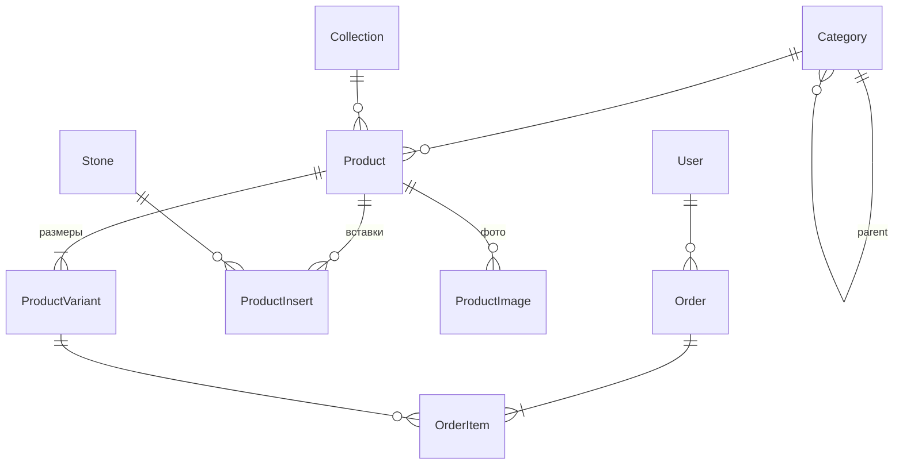

# LLD: Модель данных v0.1

Источник истины — код моделей в `backend/apps/*/models.py`. Этот документ объясняет **почему** модель такая и как она связана с 1С и Bitrix24. При изменении моделей документ обновляется в том же PR.

## Схема

## accounts

### User (ADR-0007)

| Поле | Тип | Примечание |
|---|---|---|
| phone | char(13), unique | Логин. Формат `+998XXXXXXXXX`, нормализуется в `normalize_phone()` |
| email, first_name, last_name | | необязательные |
| is_staff, is_active, is_superuser | bool | доступ в админку |
| bitrix_contact_id | char | ID контакта в Bitrix24, чтобы не создавать дубли |

### PhoneCode (ADR-0010)

Одноразовый код входа.

| Поле | Описание |
|---|---|
| `phone` | номер телефона |
| `code_hash` | HMAC-SHA256 от `телефон:код` на ключе `SECRET_KEY`; сам код не хранится |
| `created_at` | время создания |
| `attempts` | число попыток ввода |
| `used_at` | когда код использован |

Действующий код — последний неиспользованный, созданный не раньше 5 минут назад.

## catalog

Поля с пометкой 🌐 переводятся (django-modeltranslation, ADR-0004): в БД хранятся как `name_uz`, `name_ru`, `name_en`. API отдаёт поле на языке из `Accept-Language`; при пустом переводе — на русском.

### Category

| Поле | Примечание |
|---|---|
| name 🌐, description 🌐, seo_title 🌐, seo_description 🌐 | |
| slug | ЧПУ: `/ru/catalog/rings` |
| parent | дерево 2–3 уровня (Кольца → Обручальные) |
| external_id | ID группы в 1С |
| sort_order, is_active | |

### Collection

name 🌐, slug, description 🌐, image, SEO 🌐, sort_order, is_active.

### Stone

Справочник камней: name 🌐, slug. Используется в фильтре «Вставка».

### Product — изделие

| Поле | Примечание |
|---|---|
| sku | артикул, уникальный; по нему же привязываются фото из 1С |
| external_id | ID номенклатуры в 1С |
| name 🌐, description 🌐, care 🌐, SEO 🌐 | |
| slug | ЧПУ товара; по умолчанию из артикула |
| category, collection | |
| gender | women / men / unisex / kids |
| metal | gold / silver / platinum |
| metal_color | yellow / white / red / combined |
| purity | проба: 585, 750, 925… |
| video_url, is_new, is_active, sort_order | |

### ProductVariant — размер (ADR-0008)

| Поле | Примечание |
|---|---|
| product | |
| sku | артикул варианта, уникальный |
| external_id | ID характеристики в 1С |
| size | пусто для изделий без размера |
| weight | г, у каждого размера свой |
| price, old_price | сум |
| stock | остаток из 1С |

Ограничение: уникальная пара `(product, size)`.

**Агрегаты.** Цена «от», старая цена и общий остаток считаются подзапросами (`apps/catalog/queries.py::with_prices`), а не через JOIN. Иначе фильтры по размеру и камню умножают строки, и суммы задваиваются. Тест — `test_aggregates_not_duplicated_by_joins`.

### ProductInsert

product, stone, count, carat, color, clarity.

### ProductImage

product, image, alt 🌐, sort_order. Первое фото — обложка в каталоге.

## orders

### Order

| Поле | Примечание |
|---|---|
| number | `SZ-000123`, присваивается после первого сохранения |
| user | может быть пустым (заказ без регистрации) |
| status | new → confirmed → paid → packing → shipped → delivered → completed; cancelled, returned (по КП) |
| customer_name, customer_phone, customer_email | копия контактов на момент заказа |
| delivery_method | courier / pickup |
| address, comment | |
| payment_method | uzqr / on_receipt |
| payment_status | pending / paid / failed / refunded |
| subtotal, delivery_cost, total | `recalc_totals()` |
| language | язык сайта, на котором оформлен заказ (для уведомлений) |
| onec_id, bitrix_deal_id | ID в 1С и сделки в Bitrix24 |

### OrderItem

variant (может стать пустым, если вариант удалят), **копии** product_name, sku, size, price на момент заказа, quantity. Изменение цены в каталоге не меняет старые заказы — тест `test_item_snapshot_survives_price_change`.

## Что появится дальше

| Этап | Изменения |
|---|---|
| 03 ✅ | Корзина и избранное в браузере (ADR-0009), PhoneCode. Сохранённые адреса — по запросу заказчика |
| 04 | Журнал обмена с 1С: `ExchangeLog` (время, направление, объём, ошибки) |
| 06 | `Payment` (UZQR): id транзакции, сумма, статус, сырой callback, ключ идемпотентности |
